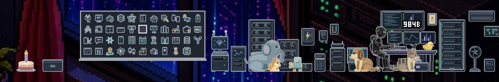
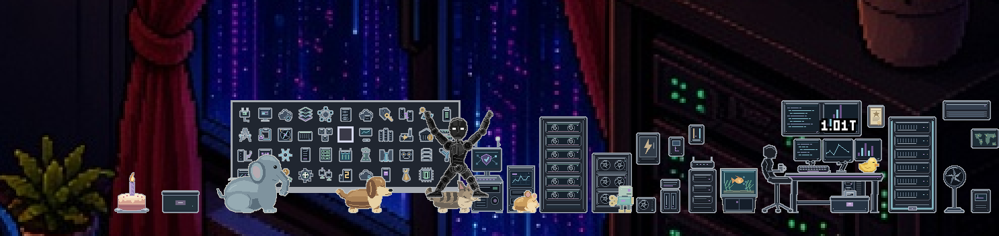
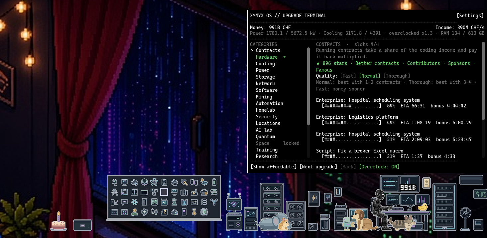

<div align="center">

```text
██╗██████╗ ██╗     ███████╗   ███████╗██╗  ██╗███████╗
██║██╔══██╗██║     ██╔════╝   ██╔════╝╚██╗██╔╝██╔════╝
██║██║  ██║██║     █████╗     █████╗   ╚███╔╝ █████╗
██║██║  ██║██║     ██╔══╝     ██╔══╝   ██╔██╗ ██╔══╝
██║██████╔╝███████╗███████╗██╗███████╗██╔╝ ██╗███████╗
╚═╝╚═════╝ ╚══════╝╚══════╝╚═╝╚══════╝╚═╝  ╚═╝╚══════╝
```

**A tiny idle game that lives on your Windows desktop.**


</div>

<div align="center">







</div>

```text
  ▄██████▄
 ██████████
 ██  ██  ██           ┌────────────────────┐
 ██████████           │ $ ./work --idle    │
  ▀██████▀            │ > +1.2K CHF/s      │
    ████              │ > commits: 1337    │
 ▄████████▄           │ $ _                │
██ ██████ ██          └──────────┬─────────┘
██ ██████ ██      ═══════════════╧════════════
   ██  ██          ║                        ║
   ██  ██          ║                        ║
```

## `$ whoami`

**XYMYX** is a black android with glowing white eyes. He sits at a mini desk right above your taskbar and codes all day. He earns money, you buy him better hardware, and his setup grows visibly in his little room. Later he takes contracts, learns new skills, runs research, opens offices, buys other companies and finally sells his own to start over a bit wiser.

## `$ ls features/`

```text
features/
├── desktop-pet         transparent always-on-top strip above the taskbar, clicks pass through,
│                       hides while a fullscreen game or video runs
├── settings            size, monitor, mouse reactions, sleep time, events, pets, FPS, fullscreen, taskbar
├── stats               playtime, earnings, contracts, flags, upgrades and more
├── idle-economy        99 upgrades · 14 categories · power, cooling & RAM budget
├── visible-setup       laptop → gaming PC → server racks → AI lab → quantum → orbit
├── contracts           client jobs, product updates, open-source stars, automation
├── progression         5 skills · 6 research projects · 5 locations · 5 acquisitions
├── ctf-flags           36 flags, each unlocks a tool with a permanent bonus
├── prestige            sell the company for know-how points and a specialization
├── random-events       a «!» pops up, click to decide or let the default happen
├── personality         types, stretches, drinks coffee, waves, naps, phones, talks to the rubber duck
├── charging-cabinet    XYMYX steps into his charging cabinet now and then and recharges
├── server-repair       devices break down now and then, XYMYX fetches the toolbox and fixes them
├── pets                rubber duck, cat, robot toy, hamster, dog, aquarium, baby elephant
├── play-rounds         click the toy box: laser, balls, ring and gear for the pets
├── seasons             Halloween, Christmas, New Year, Swiss National Day, idle.exe birthday
├── interaction         pick him and the pets up, throw them, combo jumps, drag the whole desk
├── pixel-art           hand-drawn, 3× resolution (XYMYX 144×144), sharp at whole-number scaling
├── offline-progress    keeps earning while closed (up to 8 h)
├── i18n                English + German, switch via the tray icon
└── low-footprint       max. 20 FPS, only redraws when something changes
```

## `$ cat privacy.txt`

```text
keyboard ......... not read
files ............ not read
git repos ........ not read
network .......... none
mouse position ... used, so XYMYX can react to your cursor
save file ........ stays on your computer
system status .... OFF by default (opt-in in the settings)
fullscreen check . only whether the foreground window fills the screen (to hide XYMYX)
date ............. only for the seasonal decoration
autostart ........ OFF by default; if on: one value in HKCU\...\CurrentVersion\Run
```

**System status (opt-in):** if you switch it on, right-click XYMYX → «System status» shows CPU load, RAM, free disk space, uptime, GPU load and GPU temperature (NVIDIA only). A small helper (`idle-sysinfo.exe`, source in `tools/sysinfo/`) reads these values once per second, only while that view is open. They are only displayed: never saved, never sent anywhere, and they don't affect the game. No CPU temperature (that would need a kernel driver).

## `$ man controls`

| Input | Effect |
|---|---|
| `click` XYMYX | jump · click faster for higher combo jumps |
| `drag` XYMYX | pick him up, carry and throw him |
| `click` desk | open the upgrade terminal |
| `click` pet | pet it · duck squeaks · robot toy gets wound up |
| `drag` pet | lift it and drop it (the robot toy falls over) |
| `click` toy box | start a play round for the pets |
| `drag` desk | move the whole strip (position is saved) |
| `right click` | menu: pause, system status (if on), reset strip, quit |
| tray icon | left: terminal · right: menu incl. language |

## `$ ./run`

**Download:** grab the ZIP from the [latest release](https://github.com/XYMYX/idle.exe/releases/latest), unpack it and start `idle.exe`. No installer. `idle-sysinfo.exe` is only needed for the optional system status and must stay next to `idle.exe`.

> Windows SmartScreen may warn because the file isn't signed: «More info» → «Run anyway».

**From source:**

```bash
# 1. install Godot 4.7 (standard, not .NET): https://godotengine.org/download
# 2. clone
git clone https://github.com/XYMYX/idle.exe.git
# 3. Godot -> Import -> select idle.exe/project.godot
# 4. press F5
```

> If the game opens inside the editor's «Game» tab, turn off embedding there, otherwise the transparent window won't work.

Windows only. Tested on Windows 11 at 150 % display scaling.

## `$ ls %APPDATA%\Godot\app_userdata\idle.exe\`

```text
save.json      game progress, auto-saved every 30 s and on quit
settings.cfg   strip position and language
```

## `$ tree -L 1`

```text
idle.exe/
├── scripts/          GDScript source: economy, events, XYMYX, terminal, ...
├── art/              sprites and icons (pixel art)
├── art_src/          Aseprite source files
├── i18n/             translations.csv (English source → German)
├── docs/DESIGN.md    game design, roadmap, sprite specs
└── project.godot     Godot 4.7 project
```

## `$ cat LICENSE`

```text
code ............ MIT           → LICENSE
art & XYMYX ..... CC BY-NC 4.0  → LICENSE-ART.md
```

- **Code:** [MIT](LICENSE) – use, modify and share freely, keep the copyright notice.
- **Artwork and the character XYMYX:** [CC BY-NC 4.0](LICENSE-ART.md) – share and adapt with credit, but not for commercial use.

## `$ cat CREDITS`

Code written together with [Claude](https://claude.com/claude-code) (Anthropic) as a pair programmer. Pixel art, the character XYMYX and the game design by XYMYX.
